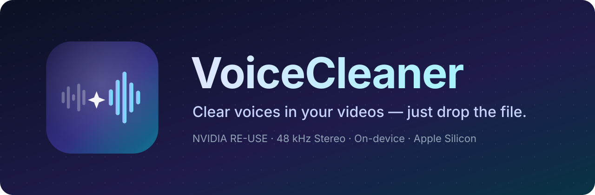
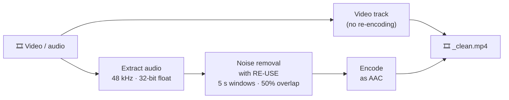

  

  <a href="README.md">日本語</a> · <b>English</b>

  
  
  
  
  
  

  <b>VoiceCleaner</b> is a macOS app that removes background noise from the voices in your videos and audio files — just drop a file onto the window. 
  It runs NVIDIA's speech enhancement model <a href="https://huggingface.co/nvidia/NVIDIA-NemotronLabs-RE-USE">RE-USE</a> on your Mac's GPU and never touches the video itself.

---

## ✨ Features

<table>
<tr>
<td width="50%" valign="top">

### 🎬 Video stays untouched
The video track is copied without re-encoding; only the audio is replaced. Picture quality is identical to the original.

### 🎧 48 kHz stereo
Audio is processed at 48 kHz. Stereo stays stereo — the left and right channels are enhanced separately.

</td>
<td width="50%" valign="top">

### 🔒 Everything stays on your Mac
Your files are never uploaded. The only network access is the one-time model download (about 54 MB).

### 🧲 Drag and drop
Drop files onto the window. Multiple files are processed in order, with an estimate of the remaining time.

</td>
</tr>
</table>

## 🚀 Getting started

1. Download `VoiceCleaner.dmg` from [**Releases**](../../releases/latest).
2. Open `VoiceCleaner.dmg` and drag the app into your Applications folder.
3. Launch VoiceCleaner. On first launch it downloads the noise removal model automatically.
4. Drop a video (MP4, MOV, M4V) or audio file (M4A, WAV, …) onto the window.
5. When it finishes, **`<original name>_clean.mp4`** appears next to the original file. Click "Finderで表示" (Show in Finder) to open it.

> [!NOTE]
> The app's user interface is currently in Japanese.

## 🛠 How it works

| Item | Details |
| :-- | :-- |
| Model | NVIDIA NemotronLabs RE-USE (9.6M parameters, all 30 stages). MLX weights from [AILogDev/RE-USE-MLX-CoreML](https://huggingface.co/AILogDev/RE-USE-MLX-CoreML) |
| Inference | [MLX](https://github.com/ml-explore/mlx-swift) on the Metal GPU |
| Sample rate | 48 kHz (1920-point STFT, hop 240 — scaled exactly as in NVIDIA's inference script) |
| Windowing | 5 s windows, 50% overlap, Hann-weighted overlap-add (same scheme as NVIDIA's `inference_chunk.py`) |
| Accuracy | SNR 55.5 dB against the official PyTorch implementation (48 kHz, 2.5 s window; checked in CI) |
| Output | Video copied as is. Audio as AAC (128 kbps mono / 256 kbps stereo) |

> [!TIP]
> RE-USE looks at both past and future audio, so it is not suited to real-time use such as a virtual microphone for calls. VoiceCleaner focuses on processing files.

## 💻 Requirements

- A Mac with Apple Silicon (M1 or later), macOS 15 or later
- 16 GB of memory or more recommended (48 kHz processing with 5 s windows uses several GB)
- Processing time depends on your Mac and the length of the video

## 📄 License

- App code: Apache-2.0 ([LICENSE](LICENSE), [NOTICE](NOTICE))
- `Sources/ReuseKit` and `Sources/ReuseModelAssets`: modified from [Corvelis/RE-USE-MLX-CoreML](https://github.com/Corvelis/RE-USE-MLX-CoreML) v0.1.0 (Apache-2.0)
- Model: NVIDIA RE-USE, OpenMDW-1.1 ([licenses/NVIDIA-RE-USE.txt](licenses/NVIDIA-RE-USE.txt)). Not included in this repository; downloaded on first launch
- Dependencies: see [licenses/](licenses/)
