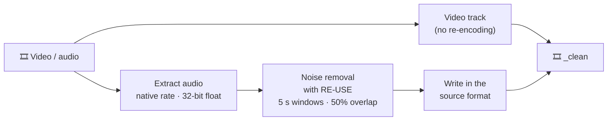

  

  <a href="README.md">日本語</a> · <b>English</b>

  
  
  
  
  
  

  <b>VoiceCleaner</b> is a macOS app that removes background noise from the voices in your videos and audio files — just drop a file onto the window. 
  It runs NVIDIA's speech enhancement model <a href="https://huggingface.co/nvidia/NVIDIA-NemotronLabs-RE-USE">RE-USE</a> on your Mac's GPU and never touches the video itself.

---

## 🎬 Demo

Click a thumbnail to play it. Each video switches back and forth between the original audio and the cleaned audio.

<table>
<tr>
<td align="center" width="50%"> Street interview at an intersection: passing cars</td>
<td align="center" width="50%"> Crowded trade show floor</td>
</tr>
<tr>
<td align="center" width="50%"> Destroyer flight deck: wind and helicopter rotor (Japanese)</td>
<td align="center" width="50%"> 15-second intro (Japanese)</td>
</tr>
</table>

Sources and licenses of the footage are listed in [docs/media/CREDITS.md](docs/media/CREDITS.md); the videos are not covered by Apache-2.0.

## ✨ Features

<table>
<tr>
<td width="50%" valign="top">

### 🎬 Video stays untouched
The video track is copied without re-encoding; only the audio is replaced. Picture quality is identical to the original.

### 🎧 Sound stays as it was
The sample rate and channel count are kept. Stereo and 5.1 are enhanced channel by channel. WAV, AIFF, FLAC and ALAC stay lossless.

</td>
<td width="50%" valign="top">

### 🔒 Everything stays on your Mac
Your files are never uploaded. The only network access is the one-time model download (about 54 MB).

### 🧲 Drag and drop
Drop files onto the window. Multiple files are processed in order, with an estimate of the remaining time.

</td>
</tr>
</table>

## 🚀 Getting started

1. Download `VoiceCleaner.dmg` from [**Releases**](../../releases/latest).
2. Open `VoiceCleaner.dmg` and drag the app into your Applications folder.
3. Launch VoiceCleaner. On first launch it downloads the noise removal model automatically.
4. Drop a video (MP4, MOV, M4V, AVI) or audio file (WAV, AIFF, FLAC, M4A, MP3, Ogg, …) onto the window.
5. When it finishes, **`<original name>_clean.<ext>`** appears next to the original file (videos keep their container; WAV→WAV, FLAC→FLAC, MP3 and others→M4A). Click "Finderで表示" (Show in Finder) to open it.

> [!NOTE]
> The app's user interface is currently in Japanese.

## 🛠 How it works

| Item | Details |
| :-- | :-- |
| Model | NVIDIA NemotronLabs RE-USE (9.6M parameters, all 30 stages). MLX weights from [AILogDev/RE-USE-MLX-CoreML](https://huggingface.co/AILogDev/RE-USE-MLX-CoreML) |
| Inference | [MLX](https://github.com/ml-explore/mlx-swift) on the Metal GPU |
| Sample rate | Processed at the source rate (8–48 kHz; STFT scaled exactly as in NVIDIA's inference script, 1920 points / hop 240 at 48 kHz). Audio above 48 kHz is processed at 48 kHz and converted back to its rate |
| Windowing | 5 s windows, 50% overlap, Hann-weighted overlap-add (same scheme as NVIDIA's `inference_chunk.py`) |
| Accuracy | SNR 55.5 dB against the official PyTorch implementation (48 kHz, 2.5 s window; checked in CI) |
| Output | Video and other audio tracks copied as is (other audio tracks are disabled so the cleaned audio plays by default). WAV, AIFF, CAF, FLAC and ALAC are written losslessly in the same format; everything else as AAC (128 kbps per channel). PCM in MOV stays PCM |

> [!TIP]
> RE-USE looks at both past and future audio, so it is not suited to real-time use such as a virtual microphone for calls. VoiceCleaner focuses on processing files.

## 📊 Evaluation

### Test sets with clean references

Noisy recordings from [VoiceBank+DEMAND](https://datashare.ed.ac.uk/handle/10283/2791) (48 kHz) and [URGENT 2024](https://urgent-challenge.github.io/urgent2024/) (16 kHz) were cleaned and compared with the clean originals. Higher is better for every metric.

| Recording | Length | PESQ (wb) | STOI | SI-SDR |
| :-- | --: | :-: | :-: | :-: |
| VoiceBank+DEMAND (several speakers joined) | 120.7 s | 1.67 → **3.13** | 0.898 → **0.943** | 5.3 → **19.2 dB** |
| VoiceBank+DEMAND p232_177 | 2.2 s | 1.34 → **2.31** | 0.792 → **0.920** | 5.4 → **15.9 dB** |
| VoiceBank+DEMAND p257_290 | 2.3 s | 1.20 → **2.51** | 0.877 → **0.950** | 6.1 → **14.9 dB** |
| VoiceBank+DEMAND p257_426 | 2.3 s | 1.12 → **2.76** | 0.841 → **0.941** | 1.1 → **16.3 dB** |
| URGENT 2024 fileid_26119 | 7.9 s | 1.05 → **1.63** | 0.588 → **0.762** | −1.4 → **6.2 dB** |

The recordings are the test fixtures of [SpeechLens](https://github.com/faraday/SpeechLens). SpeechLens runs the same RE-USE model (with the noncommercial `nvidia/RE-USE` weights) and scored about the same on every metric (PESQ 3.13 vs 3.10 on the 120.7 s recording).

### Real footage

On the 20-second excerpts behind the demo videos, loudness was measured in 0.5 s blocks. The quietest 10% shows the background noise between words; the loudest 10% shows the level of the voice.

| Footage | Background noise | Change in voice level |
| :-- | :-: | :-: |
| Crowded trade show floor | −27 dB → −72 dB | −1.3 dB |
| Street interview at an intersection | −33 dB → below −90 dB | −1.5 dB |
| Destroyer flight deck (wind, rotor) | −26 dB → below −90 dB | −1.2 dB |

Background noise drops by 40 dB or more while the voice keeps its level.

### Processing time

Time to clean 120 s of mono audio on an Apple M4 Max (128 GB). Stereo takes about twice as long, since each channel is processed separately.

| Sample rate | Time |
| :-- | --: |
| 48 kHz | 83 s |
| 44.1 kHz | 77 s |
| 16 kHz | 32 s |

## 💻 Requirements

- A Mac with Apple Silicon (M1 or later), macOS 15 or later
- 16 GB of memory or more recommended (48 kHz processing with 5 s windows uses several GB)
- Files must be readable by macOS (AVFoundation); MKV and WebM are not supported
- Processing time depends on your Mac and the length of the video

## 📄 License

- App code: Apache-2.0 ([LICENSE](LICENSE), [NOTICE](NOTICE))
- `Sources/ReuseKit` and `Sources/ReuseModelAssets`: modified from [Corvelis/RE-USE-MLX-CoreML](https://github.com/Corvelis/RE-USE-MLX-CoreML) v0.1.0 (Apache-2.0)
- Model: NVIDIA RE-USE, OpenMDW-1.1 ([licenses/NVIDIA-RE-USE.txt](licenses/NVIDIA-RE-USE.txt)). The weights are converted from [nvidia/NVIDIA-NemotronLabs-RE-USE](https://huggingface.co/nvidia/NVIDIA-NemotronLabs-RE-USE), which allows commercial use; the older `nvidia/RE-USE` release (noncommercial NSCLv1) is a different checkpoint. Not included in this repository; downloaded on first launch
- Dependencies: see [licenses/](licenses/)
