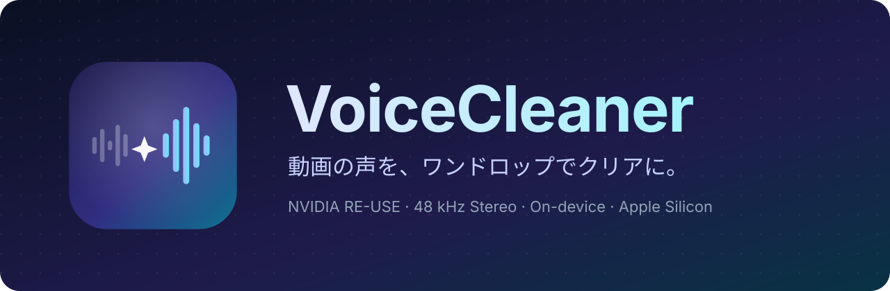
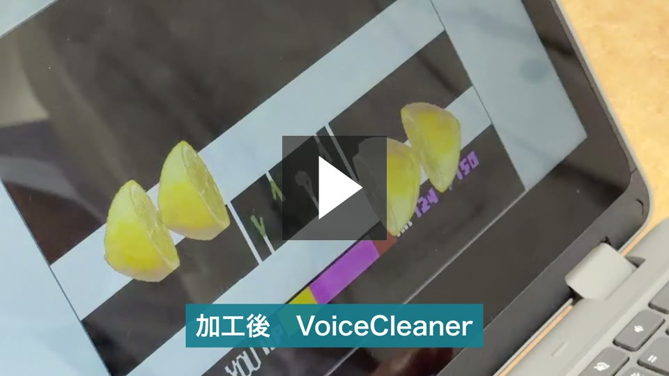
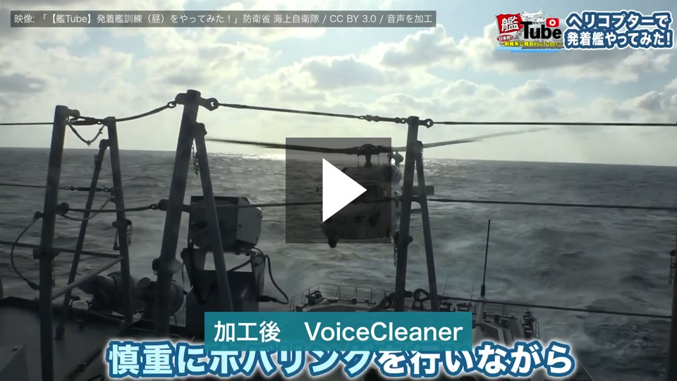
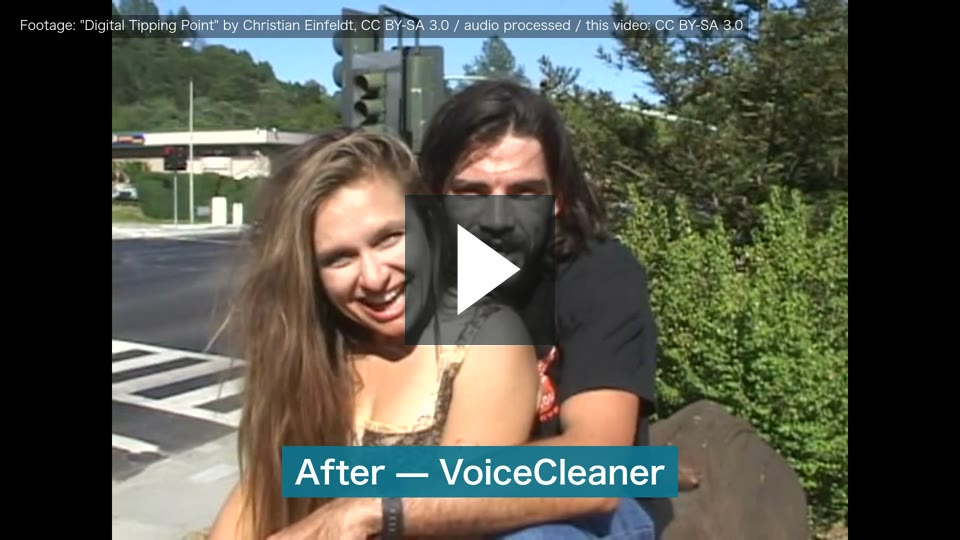
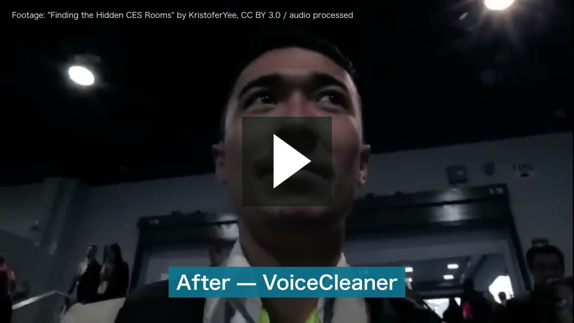
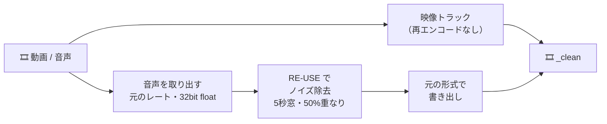

  

  <b>日本語</b> · <a href="README.en.md">English</a>

  
  
  
  
  
  

  <b>VoiceCleaner</b> は、動画や音声ファイルをドロップするだけで、声の背景ノイズを取り除く macOS アプリです。 
  NVIDIA の音声強調モデル <a href="https://huggingface.co/nvidia/NVIDIA-NemotronLabs-RE-USE">RE-USE</a> を Mac の GPU で動かし、映像には一切手を加えません。

---

## 🎬 デモ

サムネイルをクリックすると再生できます。どの動画も、加工前の音と加工後の音を交互に流しています。

<table>
<tr>
<td align="center" width="50%"> 紹介動画（15秒）</td>
<td align="center" width="50%"> 護衛艦の甲板：強風とヘリのローター音</td>
</tr>
<tr>
<td align="center" width="50%"> 交差点での街頭インタビュー：車の走行音（英語）</td>
<td align="center" width="50%"> 展示会場の雑踏（英語）</td>
</tr>
</table>

素材の出典とライセンスは [docs/media/CREDITS.md](docs/media/CREDITS.md) にまとめています（Apache-2.0 の対象外です）。

## ✨ 特長

<table>
<tr>
<td width="50%" valign="top">

### 🎬 映像はそのまま
映像は再エンコードせずにコピーし、音声だけを差し替えます。画質は元のファイルと同じです。

### 🎧 元の音のまま
サンプルレートとチャンネル数はそのまま。ステレオや 5.1ch は各チャンネルを別々に処理します。WAV・AIFF・FLAC・ALAC は可逆のまま書き出します。

</td>
<td width="50%" valign="top">

### 🔒 すべて Mac の中で
ファイルを外部に送信しません。通信は初回のモデル取得（約54 MB）だけです。

### 🧲 ドラッグ＆ドロップ
ファイルをウィンドウに落とすだけ。複数ファイルは順番に処理し、残り時間も表示します。

</td>
</tr>
</table>

## 🚀 使い方

1. [**Releases**](../../releases/latest) から `VoiceCleaner.dmg` をダウンロードします。
2. `VoiceCleaner.dmg` を開き、アプリを「アプリケーション」フォルダへドラッグします。
3. VoiceCleaner を起動します。初回だけ、ノイズ除去モデルを自動でダウンロードします。
4. 動画（MP4・MOV・M4V・AVI）や音声（WAV・AIFF・FLAC・M4A・MP3・Ogg など）をウィンドウにドロップします。
5. 完了すると、元のファイルと同じフォルダに **`元の名前_clean.<拡張子>`** ができます（動画は同じ形式、音声は WAV→WAV、FLAC→FLAC、MP3 などは M4A）。「Finderで表示」ですぐ開けます。

## 🛠 しくみ

| 項目 | 内容 |
| :-- | :-- |
| モデル | NVIDIA NemotronLabs RE-USE（9.6M パラメータ・全30段）。MLX 版の重みは [AILogDev/RE-USE-MLX-CoreML](https://huggingface.co/AILogDev/RE-USE-MLX-CoreML) から取得 |
| 推論 | [MLX](https://github.com/ml-explore/mlx-swift)（Metal GPU） |
| サンプルレート | 元のレートのまま処理（8–48 kHz。STFT は NVIDIA の推論スクリプトと同じ換算で、48 kHz なら 1920 点・ホップ 240）。48 kHz を超える音声は 48 kHz で処理し、元のレートに戻して書き出し |
| 処理窓 | 5 秒窓・50% 重なり・Hann 窓で重ね合わせ（NVIDIA `inference_chunk.py` と同じ方式） |
| 精度 | 公式 PyTorch 実装との比較で SNR 55.5 dB（48 kHz・2.5 秒の窓、CI で毎回検証） |
| 出力 | 映像と他の音声トラックはそのままコピー（他の音声トラックは無効にして、処理済みの音声が既定で再生されるようにします）。音声は WAV・AIFF・CAF・FLAC・ALAC なら同じ形式で可逆、それ以外は AAC（1 チャンネルあたり 128 kbps）。MOV 内の PCM は PCM のまま |

> [!TIP]
> RE-USE は前後の音声を参照するモデルのため、リアルタイム処理（通話用の仮想マイクなど）には向きません。VoiceCleaner はファイルをまとめて処理する用途に特化しています。

## 📊 性能評価

### 正解の音声がある評価用データ

[VoiceBank+DEMAND](https://datashare.ed.ac.uk/handle/10283/2791)（48 kHz）と [URGENT 2024](https://urgent-challenge.github.io/urgent2024/)（16 kHz）の雑音入り音声を処理し、雑音のない元の音声と比べました。どの指標も大きいほど良い値です。

| 音声 | 長さ | PESQ（wb） | STOI | SI-SDR |
| :-- | --: | :-: | :-: | :-: |
| VoiceBank+DEMAND（複数話者をつないだもの） | 120.7 秒 | 1.67 → **3.13** | 0.898 → **0.943** | 5.3 → **19.2 dB** |
| VoiceBank+DEMAND p232_177 | 2.2 秒 | 1.34 → **2.31** | 0.792 → **0.920** | 5.4 → **15.9 dB** |
| VoiceBank+DEMAND p257_290 | 2.3 秒 | 1.20 → **2.51** | 0.877 → **0.950** | 6.1 → **14.9 dB** |
| VoiceBank+DEMAND p257_426 | 2.3 秒 | 1.12 → **2.76** | 0.841 → **0.941** | 1.1 → **16.3 dB** |
| URGENT 2024 fileid_26119 | 7.9 秒 | 1.05 → **1.63** | 0.588 → **0.762** | −1.4 → **6.2 dB** |

評価用の音声は [SpeechLens](https://github.com/faraday/SpeechLens) のテスト用データを使いました。同じ RE-USE を使う SpeechLens（重みは非商用版の `nvidia/RE-USE`）とは、どの指標もほぼ同じ値でした（120.7 秒の音声で PESQ 3.13 対 3.10）。

### 実際の映像

上のデモ動画の元になった 20 秒の区間で、0.5 秒ごとの音量を測りました。話していないときの音量（下位 10%）が背景の雑音、話しているときの音量（上位 10%）が声の大きさの目安です。

| 映像 | 背景の雑音 | 声の大きさの変化 |
| :-- | :-: | :-: |
| 展示会場の雑踏 | −27 dB → −72 dB | −1.3 dB |
| 交差点での街頭インタビュー | −33 dB → −90 dB 未満 | −1.5 dB |
| 護衛艦の甲板（強風・ローター音） | −26 dB → −90 dB 未満 | −1.2 dB |

背景の雑音は 40 dB 以上下がり、声の大きさはほとんど変わりません。

### 処理時間

Apple M4 Max（メモリ 128 GB）で、モノラル 120 秒の音声にかかった時間です。ステレオはチャンネルごとに処理するため、およそ 2 倍かかります。

| サンプルレート | 処理時間 |
| :-- | --: |
| 48 kHz | 83 秒 |
| 44.1 kHz | 77 秒 |
| 16 kHz | 32 秒 |

## 💻 動作環境

- Apple Silicon（M1 以降）の Mac、macOS 15 以降
- メモリ 16 GB 以上を推奨（48 kHz・5 秒窓の処理で数 GB を使います）
- 開ける形式は macOS（AVFoundation）が読めるものです。MKV・WebM は開けません
- 処理時間は、Mac の性能と動画の長さによって変わります

## 📄 ライセンス

- アプリのコード：Apache-2.0（[LICENSE](LICENSE)・[NOTICE](NOTICE)）
- `Sources/ReuseKit`・`Sources/ReuseModelAssets`：[Corvelis/RE-USE-MLX-CoreML](https://github.com/Corvelis/RE-USE-MLX-CoreML) v0.1.0（Apache-2.0）を改変
- モデル：NVIDIA RE-USE、OpenMDW-1.1（[licenses/NVIDIA-RE-USE.txt](licenses/NVIDIA-RE-USE.txt)）。商用利用も可能な [nvidia/NVIDIA-NemotronLabs-RE-USE](https://huggingface.co/nvidia/NVIDIA-NemotronLabs-RE-USE) 版から変換した重みを使います（非商用ライセンス NSCLv1 の旧 `nvidia/RE-USE` とは別物です）。リポジトリには含まず、初回起動時にダウンロードします
- 依存ライブラリ：[licenses/](licenses/) を参照
